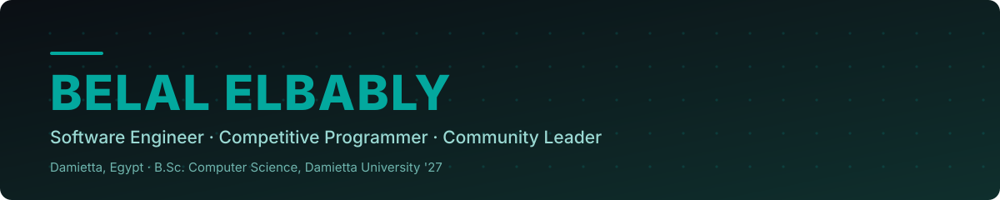
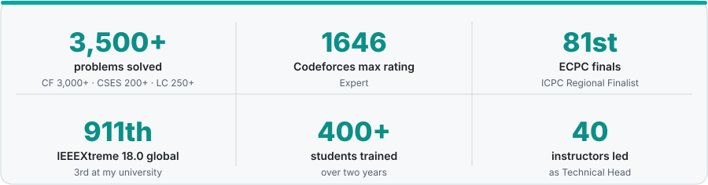

<div align="center">




[](https://linkedin.com/in/elbably)
[](mailto:belal.m.elbably@gmail.com)
[](https://dcchub.xyz/)

<picture>
  <source media="(prefers-color-scheme: dark)" srcset="assets/stats-dark.svg" />
  
</picture>

</div>

## whoami

```text
┌─────────────────────────────────────────────────────────────────┐
│ name      : Belal Elbably                                       │
│ role      : Software Engineer · Competitive Programmer          │
│ education : B.Sc. Computer Science, Damietta University '27     │
│ cp        : Codeforces Expert (1646) · ICPC Regional Finalist   │
│ leads     : ACPC Damietta · DCC                                 │
│ focus     : backend APIs (Node, Django, FastAPI) · algorithms   │
│ learning  : RAG · LLMs · system design · cloud · DevOps         │
│ open to   : freelance work · collaborations                     │
└─────────────────────────────────────────────────────────────────┘
```

I build backend APIs with Node.js, Django and FastAPI, and I've solved **3,500+ problems** on Codeforces (3,000+), CSES (200+), LeetCode (250+), AtCoder, HackerRank and more. Based in Damietta, Egypt.

**Interests:** entrepreneurship, teaching, community building. **Goals:** reach Candidate Master on Codeforces and compete at the ICPC World Finals.

## Tech stack

**Languages**&nbsp;


**Backend**&nbsp;


**Data**&nbsp;


**DevOps**&nbsp;


<details>
<summary>Full skills list</summary>

<br />

| Area | Technologies |
| :--- | :--- |
| **Languages** | `Python` `C++` `JavaScript` `TypeScript` `SQL` |
| **Backend** | `Django` `FastAPI` `Node.js` `Express.js` `REST API design` `JWT authentication` `RBAC` `MVC` `Mongoose` |
| **Databases** | `MongoDB` `PostgreSQL` `MySQL` `SQLite` `Neo4j` `SQL Server` |
| **Cloud & DevOps** | `Docker` `Linux / Unix` `Git workflows` `Railway` `Vercel` |
| **Testing** | `Jest` `Vitest` |
| **Exploring** | `RAG` `LLMs` `System design` `Cloud` `DevOps` |
| **Computer science** | Data structures, algorithms, graph theory, dynamic programming, OOP, operating systems, computer networks, database systems |

</details>

## Featured projects

### [iLoveMarked](https://ilovemarked.online)

Free, privacy-first converter that turns Markdown into formatted LinkedIn posts, entirely in the browser. Arabic RTL support, offline-first PWA, 50-state undo/redo, local draft history, PDF export.

```text
JavaScript · Vite · Tailwind · PWA · Vitest
```

<table>
<tr>
<td valign="top" width="33%">

<b><a href="https://github.com/B-Elbably/Railway-to-ACPC">Railway-to-ACPC</a></b><br />
870+ solutions and 50+ C++ templates, with workspace automation scripts.<br /><br />
<code>C++ · Python · Bash</code>

</td>
<td valign="top" width="33%">

<b><a href="https://github.com/B-Elbably/python-survival-kit">python-survival-kit</a></b><br />
Data structures and algorithms in Python, a quick reference for Python programmers.<br /><br />
<code>Python</code>

</td>
<td valign="top" width="33%">

<b><a href="https://github.com/B-Elbably/mini-rag">mini-rag</a></b> (in development)<br />
Retrieval-Augmented Generation app that turns uploaded documents into searchable chunks for AI question answering.<br /><br />
<code>Python · FastAPI · MongoDB · LangChain</code>

</td>
</tr>
</table>

## Honors & experience

<details>
<summary>Competitions and honors</summary>

<br />

| Event | Result |
| :--- | :--- |
| **ECPC finals** | 81st place, 6 problems solved, team *Birthday Paradox* — **ICPC Regional Finalist** |
| **ECPC 2027 qualification** | **6th place**, 8 problems solved, with a first solve; 1st among my university's teams ([standings](https://icpc.global/regionals/finder/ECPCQDAYTWO-2027/standings)) |
| **IEEEXtreme 18.0** | 3rd university-wide, **911th globally** out of 5,800+ participants |
| **ECPC qualifiers (earlier attempt)** | 18th place among 300+ teams |
| **Codeforces** | Expert, max rating **1646** ([Belal.echo](https://codeforces.com/profile/Belal.echo)) |

</details>

<details>
<summary>Leadership and mentoring</summary>

<br />

| Role | Period | Impact |
| :--- | :--- | :--- |
| **Founder, Manager & PR**, [Damietta Competitive Contest (DCC)](https://dcchub.xyz/) | 2026 – present | Founded an ICPC-style programming competition for Damietta's universities and institutes, and run it from planning through the final round |
| **Community Leader**, ACPC Damietta University | Mar 2026 – present | Run the whole community: managed Technical, Media, HR, PR and OC teams. **400+ students trained over two years**; **6 teams qualified for ECPC finals** and **3 for ACPC finals**. Built partnerships with CSKiller Academy, 7D Hub and Zawolf.ai |
| **Head of Competitive Programming Committee**, IEEE Damietta Branch | Mar 2025 – Sep 2026 | Organized advanced problem-solving workshops and prepared students for IEEEXtreme and ICPC |
| **Technical Head & Instructor**, ACPC Damietta University | Nov 2024 – Oct 2025 | Managed training, sessions and problem setting: created a full Data Structures & Algorithms curriculum, led 40 instructors, and mentored several teams to ECPC qualification |

**Events organized**

- Damietta Competitive Contest (DCC), founded and led from planning to the final round
- ACPC DU Newcomers Event 2026, 13 October 2026, Faculty of Computers and AI, Damietta University
- Training sessions and workshops for IEEE Damietta Branch members

</details>

## Competitive profiles

<div align="center">

[](https://codeforces.com/profile/Belal.echo)
[](https://cses.fi/user/277252)
[](https://leetcode.com/u/belalelbably700/)

<sub>Second Codeforces account: <a href="https://codeforces.com/profile/Belal">Belal</a> · Also practising on AtCoder and HackerRank</sub>

</div>

## Get in touch

[LinkedIn](https://linkedin.com/in/elbably) · [Email](mailto:belal.m.elbably@gmail.com) · [DCC](https://dcchub.xyz/) · [Codeforces](https://codeforces.com/profile/Belal.echo) · [LeetCode](https://leetcode.com/u/belalelbably700/)
